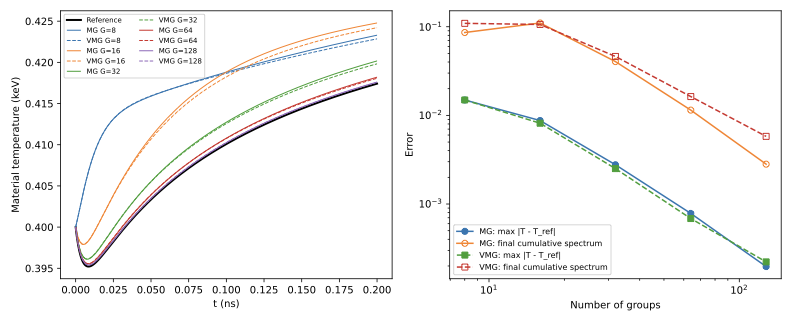
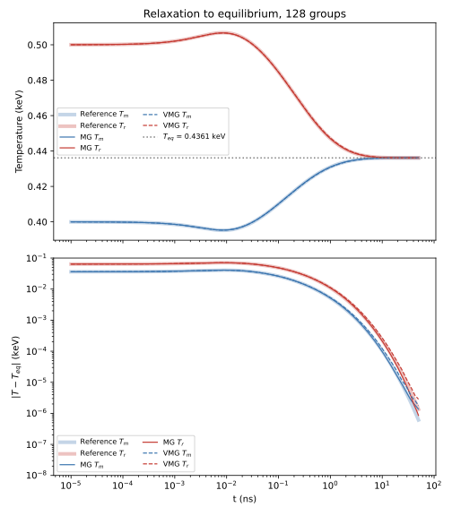
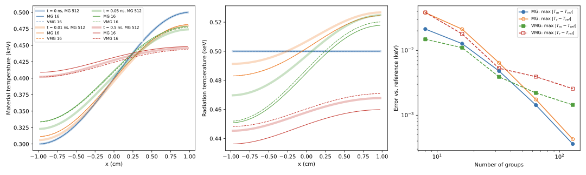

# Solver Bug Report: One-Dimensional Multigroup / Variable-Basis Code

This report covers the code on branch `solver-bugfixes`. Bugs 1–6 are fixed on this branch. Items 7–12 are documented but **not** fixed; item 12 is a limitation of the VMG discretization found with the 1-D test (Test C).

Throughout, **MG** is the standard multigroup solver (`CoupledEquations` in `Logic.py`) and **VMG** is the variable-basis (moving-coordinate) solver (`MovingMeshEquations` in `Logic.py`).

## What is correct

Several errors in the write-up (*Multigroup First Crack*) do **not** appear in the code:

- The code uses $B$ as the Planck *intensity* consistently: the transport source is $\sigma B$, and the material equation uses $4\pi\sigma B$ and $\phi = 4\pi\sum_m w_m\psi_m$.
- The MG source is $Q^* = \sigma_g \bar B_g + \psi^n/(c\Delta t)$, and the $\mu<0$ sweep uses $|\mu|$.
- The VMG sweep implements the conservative form
  $$\frac{1}{c}\frac{\partial\hat\psi}{\partial t} + \mu\frac{\partial\hat\psi}{\partial x} - \frac{1}{T}\left(\frac{1}{c}\frac{\partial T}{\partial t} + \mu\frac{\partial T}{\partial x}\right)\frac{\partial(u\hat\psi)}{\partial u} = \sigma_a(\hat B - \hat\psi)$$
  with upwinding in $u$ set by the sign of the coefficient, $\hat B\propto T^4$, and the correct material equation. The $T$-factor error in Eq. (42) of the write-up is not in the code.

## Bugs fixed on this branch

### 1. First sweep of each time step uses the previous step's data (MG and VMG)

**Where:** `Base.converge()` calls `rhsUpdate()` before `radiationSweep()`, but `psi_old` and `timeTerm` are advanced in `startTimeStep()`, which runs inside `radiationSweep()`.

**Effect:** The first sweep of each step builds $Q^*$ from $\psi^{n-1}$. That sweep can reproduce $\psi^n$ almost exactly and pass the convergence check, while the material temperature still updates. Radiation does not advance but the material does, so energy is not conserved. In the test problem, VMG lost 0.13% of the total energy in a single step this way, and its error vs. the reference stopped decreasing past 64 groups.

**Fix:** `rhsUpdate()` now calls `startTimeStep()` first, in both `CoupledEquations` and `MovingMeshEquations`.

### 2. MG convergence check never compares successive iterates

**Where:** `CoupledEquations.startTimeStep()` (and the uncoupled `Equations` class used for Reed's problem) never updated `grid.fullTensOld` between iterations.

**Effect:** The quantity checked against the tolerance was $|\psi^{k} - \psi^{n}|$ (current iterate vs. previous time step) rather than $|\psi^{k}-\psi^{k-1}|$. Iterations ended only through the "stagnation" check or by hitting `maxIters`. This inflated MG run times and made MG vs. VMG timing comparisons unfair.

**Fix:** The same-step branch of `startTimeStep()` now sets `grid.fullTensOld` to the latest iterate (as VMG already did).

### 3. MG right reflective boundary lags one full time step

**Where:** `CoupledEquations.radiationSweep()` reads the reflected incoming intensity from `self.fullTens`, which was only refreshed at the start of each time step.

**Effect:** Intensity entering at the right wall was $\psi^n$ instead of the current iterate. In an infinite-medium test this made the solution non-uniform in space and caused a relative energy error of about $10^{-4}$.

**Fix:** `self.fullTens` is refreshed every iteration in `startTimeStep()`.

### 4. Saved radiation history is off by one step

**Where:** `Base.updateAll(index)` wrote the solution at $t_{index+1}$ into slot `index`, overwriting the initial condition. The temperature for the same step was written to slot `index+1`.

**Effect:** Radiation and material temperature were misaligned by one step in every saved file and plot. The final slot stayed empty, which is why `Run.py` slices with `[:-1]`. With log time stepping the last step is about 6% of the total time, so plots of $T_r$ vs. $T_m$ were visibly shifted.

**Fix:** The solution is now stored in slot `index+1`. `checkEnergyConservation` and `Visualize.plotFinalFlux` were adjusted to match.

> **Data in `dataStash/` was produced before these fixes.** Its radiation history is shifted by one step and it may contain unconverged steps. Comparisons built from it should be regenerated.

### 5. Material update was an unlinearized fixed-point iteration (MG and VMG)

**Where:** `materialEquation()` updated $T$ with $\sigma$ and $B$ evaluated at the previous iterate. The linearization $T^4_{n+1}\approx T^4_n + 4T^3_n(T^{n+1}-T^n)$ from the write-up was never used. This is probably why the learning rate, polynomial extrapolation, and stagnation workarounds exist.

**Effect:** The iteration fails for large time steps. In the infinite-medium equilibrium problem ($C_v = 0.01$):

- MG overflowed (`FloatingPointError`) once $\Delta t \gtrsim 0.2$–$0.3$ ns.
- VMG kept running at $\Delta t\approx 0.3$ ns but finished at $T = 0.147$ keV instead of $0.436$ keV, **with no warning**.

**Fix:** Each material update is now a Newton step with emission linearized about the current iterate $T_k$:

$$T_{k+1} = T_k + \frac{T^n - T_k + \frac{\Delta t}{C_v}\sum_g \sigma_g\left(\phi_g - 4\pi \bar B_g(T_k)\right)}{1 + \frac{\Delta t}{C_v}\,4\pi\sum_g \sigma_g\, \bar B_g'(T_k)}.$$

MG uses a new `planckBarDeriv()` (Simpson integral of $\partial B/\partial T$). VMG uses $\partial \hat B_g/\partial T = 4\hat B_g/T$, since $\hat B_g\propto T^4$ at fixed $u$. Each iteration is now a contraction for any $\Delta t$. The fixed point, and therefore the converged answer, is unchanged.

**Verified:** With time steps up to $\Delta t = 1.27$ ns, both methods now reach $T_{eq}=0.4361$ keV. Energy drift at those very large steps is still $3$–$7\times10^{-5}$. The outer radiation–material iteration converges slowly when $\Delta t$ is large, and the convergence check only compares successive iterates, so it can stop early. A Fleck-type effective-scattering formulation, or a check on the temperature residual, would tighten this.

### 6. VMG Planckians were built in the initial temperature's $u$-coordinate

**Where:** `MovingMeshEquations.planckVCM()` assumed $u = \nu/T_{\text{initial}}$ (a single scalar), both for the initial condition and for Planckian boundaries. Each cell's coordinate is actually $u=\nu/T_{\text{cell}}(t)$.

**Effect:**
- The incoming boundary spectrum was wrong as soon as the boundary cell's temperature changed.
- A spatially varying initial temperature could not be represented.
- On a 20-cell slab with a 0.6 keV Planckian left boundary (64 groups), VMG went unstable, with cell temperatures of −0.31 and 1.05 keV, where MG gives about 0.56 keV.

**Fix:** `planckVCM(u, T, Tcoord)` and `planckBarInit(T, Tcoord)` take the coordinate temperature explicitly. A Planckian at $T$ in the coordinate $u=\nu/T_{\text{coord}}$ is

$$\hat B(u) = T_{\text{coord}}\,B(uT_{\text{coord}}, T) = \frac{15ac}{4\pi^5}\,\frac{u^3T_{\text{coord}}^4}{e^{uT_{\text{coord}}/T}-1}.$$

- The initial condition uses each cell's initial temperature.
- Boundaries use the boundary cell's current temperature iterate.
- Boundary spectra are cached once per iteration in `startTimeStep()`. They were previously recomputed for every group and angle.

**Verified:** On the same slab, VMG now agrees with MG to $6\times10^{-3}$ keV, consistent with the group error at 64 groups seen in Test C.

## Outstanding issues (not fixed)

### 12. VMG leaks energy through the top of the $u$-grid and converges only at first order in 1-D (important)

Found with Test C below.

**Mechanism:**
- In 1-D the coefficient of the grid-motion term, $c_m = \frac{1}{T}\left(\frac{1}{c}\partial_t T + \mu_m\partial_x T\right)$, is dominated by $\mu_m\partial_x T/T$. In Test C it is about $\pm0.07$, comparable to the opacity of the high-frequency groups.
- It is negative for roughly half the angles, which pushes photons toward higher $u$.
- The transfer between $u$-groups is first-order upwind on wide log-spaced groups, so it is very diffusive. At 16 groups, 5% of the radiation energy ends up in the top group, where the true spectrum is essentially zero.
- That energy then leaves through $u_{\max}$. The outflow uses the group-average density $\Psi_G/\Delta u_G$ as the face value.

**Confirmed:** The computed outflow through $u_{\max}$ matches the observed energy loss rate exactly. The bottom face contributes nothing.

**Consequences (Test C):**
- Energy drift falls from $8\times10^{-3}$ at 8 groups to $1.3\times10^{-5}$ at 128 groups. MG conserves energy to about $10^{-8}$.
- VMG temperature errors converge at about first order in the number of groups, versus second order for MG. VMG is more accurate than MG at 32 groups or fewer, but about 4× less accurate at 128 groups.
- In the infinite medium only $\partial_t T$ contributes, $|c_m|$ is about 100× smaller, and none of this is visible.

**Possible remedies:**
1. Set the $u$-face flux to zero at $u_{\min}$ and $u_{\max}$. The physical $u\hat\psi$ vanishes at both ends, and this restores exact energy conservation.
2. Use a limited second-order reconstruction (e.g. minmod or van Leer) of $\hat\psi$ at the $u$-faces, to recover second-order convergence in groups.
3. Extend $u_{\max}$ and/or use narrower top groups so spurious upward transport has room to decay.

Whether VMG beats MG per group in spatially varying problems depends on resolving this.

### 7. "Delta" boundary condition has inconsistent units (MG and VMG)

`boundaryPlanck()` / `setBoundaryValues()` compute `totalFlux = sum(du * Bbar_g)` and then set group $g$ to `totalFlux / du[g]`. The tensor stores *group-integrated* intensity, so the delta group should simply hold $\sum_g \bar B_g$. Because `du` is in $\nu$ units for MG and in $u$ units for VMG, the two methods inject different energies.

### 8. Group Planck integrals use one 4-point Simpson panel per group

`planckBar`, `planckg`, `planckBarNumbaVariable`, and the closed-form `sigma_a` all integrate each group with a single 3/8-rule panel. With few log-spaced groups (e.g., a factor of ~5 in frequency per group at G = 8) this is coarse. `energyInitialCondition()` rescales the initial intensity, which hides the error at $t=0$ only; the equilibrium state still carries it. Exact incomplete-Planck integrals (polylog series) or several Gauss points per group would remove it.

### 9. Default configurations crash

- `InfiniteVariable.Parameters` defaults to `boundaryLeft = boundaryRight = "None"`. `setBoundaryValues()` has no branch for that value and raises `UnboundLocalError`. `Run.py`'s `mainMovingMesh()` hits this as-is.
- `InfiniteMedium.Parameters` does not define `matchNu`, so `Base.Grid` raises `AttributeError` (affects `RunBase.mainInfinite()`).
- Both only work through `RunSet.py`, which sets these values.

### 10. Opacity helper typos (currently unused code paths)

- `sigmaAP` in `InfiniteMedium.py` and `DiffEqSolve.py` uses `T*(1/2)`, which is $T/2$, not $\sqrt{T}$.
- The variable-basis versions use $T^{7/2}$ (`InfiniteVariable.py`) and $T^{5/2}$ (`DiffEqSolve.py`), which are inconsistent with each other.

### 11. Minor

- VMG computes $\partial_x T$ with a central difference (`np.gradient`) while the spatial sweep is upwinded, so a spectrum that is uniform in $\nu$ is not preserved exactly. This is a first-order error.
- `Base.converge()` skips its first two iterations (`if it >= 2`), so the `checkEnergy` block (`it == 0`) can never run.

## Verification test 1: `GroupConvergenceTest.py` (infinite medium)

**Problem**
- Infinite homogeneous medium: 2 cells, reflective on both sides, S2.
- Temperature-independent opacity $\sigma(\nu) = 10/(1+\nu^3)$ cm$^{-1}$, $C_v = 0.01$.
- Material starts at 0.4 keV. Radiation starts as a dilute 1.0 keV Planckian carrying the energy of a 0.5 keV Planckian.

**Method**
- MG and VMG run through the production solver (`Base.Base` + `Logic`) for G = 8–128 log-spaced groups.
- The reference is a 1500-group stiff ODE solve (`solve_ivp`, BDF, analytic Jacobian), so it is exact in time.
- Run with `python GroupConvergenceTest.py` (about 2.5 minutes in total).

**Diagnostics**
- max $|T_m - T_{\text{ref}}|$ over time.
- Error in the final cumulative spectrum $\int_0^\nu\phi\,d\nu'$, normalized by the total. This compares the methods even though their group edges differ.
- Relative energy drift.
- Cell-to-cell temperature spread (should be zero in an infinite medium).

### Results before the fixes

| Method | G | max\|ΔT\| | spectrum err | energy drift | T spread |
|---|---|---|---|---|---|
| MG | 32 | 2.8e-3 | 4.0e-2 | 1.1e-4 | 2.4e-5 |
| VMG | 32 | 2.0e-3 | 4.9e-2 | 1.4e-3 | 0 |
| MG | 128 | 2.1e-4 | 2.3e-3 | 9.9e-5 | 2.5e-5 |
| VMG | 128 | 5.1e-4 | 8.5e-3 | 1.5e-3 | 0 |

VMG stopped converging beyond 64 groups (bug 1). MG had spatial non-uniformity and energy drift (bug 3).

### Results after the fixes

These are the results after fixes 1–4. Re-running after fixes 5–6 gives the same temperature and spectrum errors, with energy drift ≤ 3e-8 at every G.

| G | MG max\|ΔT\| | VMG max\|ΔT\| | max\|T_MG − T_VMG\| | MG spectrum err | VMG spectrum err | energy drift |
|---|---|---|---|---|---|---|
| 8 | 1.5e-2 | 1.5e-2 | 4.4e-4 | 8.6e-2 | 1.1e-1 | ≤ 1e-9 |
| 16 | 8.7e-3 | 8.2e-3 | 6.3e-4 | 1.1e-1 | 1.1e-1 | ≤ 3e-8 |
| 32 | 2.8e-3 | 2.5e-3 | 3.5e-4 | 4.0e-2 | 4.6e-2 | ≤ 5e-9 |
| 64 | 7.8e-4 | 6.9e-4 | 1.3e-4 | 1.1e-2 | 1.6e-2 | ≤ 8e-9 |
| 128 | 2.0e-4 | 2.2e-4 | 5.3e-5 | 2.8e-3 | 5.8e-3 | ≤ 7e-9 |

- Both methods converge to the reference at roughly second order in temperature, and toward each other.
- VMG spectra converge only at first order, as expected from first-order upwinding of the transfer between $u$-groups.
- Energy is conserved to the iteration tolerance, and the infinite medium stays uniform.

### Relaxation to equilibrium (128 groups)

`equilibrium_plot()` runs both methods to 50 ns: log-spaced steps up to 1 ns, then $\Delta t = 0.1$ ns. The plot was made before fix 5, when larger steps diverged; with fix 5, steps up to 1.27 ns also reach $T_{eq}$.

- Both methods match the reference for material and radiation temperature throughout.
- The material first cools slightly, while absorbing the dilute but spectrally hot radiation, then heats.
- Both reach the equilibrium temperature $T_{eq} = 0.43612$ keV to within about $10^{-6}$ keV.
- Full equilibration takes about 50 ns because the high-frequency tail is only weakly absorbed ($\sigma\sim10^{-3}$ cm$^{-1}$).

## Verification test 2 (Test C): `GradientRelaxationTest.py` (1-D slab with a temperature gradient)

This test exercises what the infinite medium cannot: VMG's $\mu\,\partial_x T$ term, and neighbouring cells whose $u$-groups map to different frequency ranges.

**Problem**
- Closed slab on $x\in[-1,1]$ cm with reflective walls, 40 cells, S4.
- Material starts at $T_0(x) = 0.4 + 0.1\sin(\pi x/2)$ keV, so it is asymmetric and has a nonzero gradient at both walls.
- Radiation starts as the same spatially uniform dilute Planckian as test 1. Same opacity and $C_v$.
- 200 log-spaced steps to 0.5 ns.

**Method**
- The reference is MG with 512 groups on the same mesh, angular quadrature, and time steps. It is cached in `dataStash/`. Differences from it are therefore due to the treatment of frequency, plus VMG's different spatial and time discretization of the grid-motion terms.
- Run with `python GradientRelaxationTest.py` (about 4.5 minutes including the reference).

**Results** (after fixes 1–6)

| G | MG max\|ΔT_m\| | VMG max\|ΔT_m\| | MG max\|ΔT_r\| | VMG max\|ΔT_r\| | max\|T_MG − T_VMG\| | MG energy drift | VMG energy drift |
|---|---|---|---|---|---|---|---|
| 8 | 2.1e-2 | 1.5e-2 | 3.8e-2 | 3.9e-2 | 1.5e-2 | 6e-9 | 8.2e-3 |
| 16 | 1.3e-2 | 1.1e-2 | 2.1e-2 | 1.8e-2 | 7.8e-3 | 8e-9 | 1.9e-3 |
| 32 | 4.8e-3 | 3.9e-3 | 6.4e-3 | 5.3e-3 | 5.2e-3 | 2e-8 | 5.1e-4 |
| 64 | 1.4e-3 | 2.2e-3 | 1.8e-3 | 3.9e-3 | 2.8e-3 | 3e-8 | 9.5e-5 |
| 128 | 3.6e-4 | 1.4e-3 | 4.3e-4 | 2.6e-3 | 1.6e-3 | 5e-8 | 1.3e-5 |

- MG converges at second order and conserves energy.
- VMG is more accurate than MG for $G\le 32$. Beyond that it converges at only about first order, and it loses energy through the top of the $u$-grid (issue 12).

